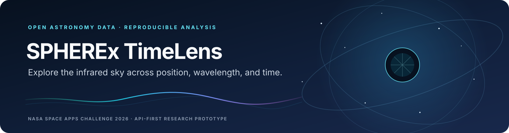
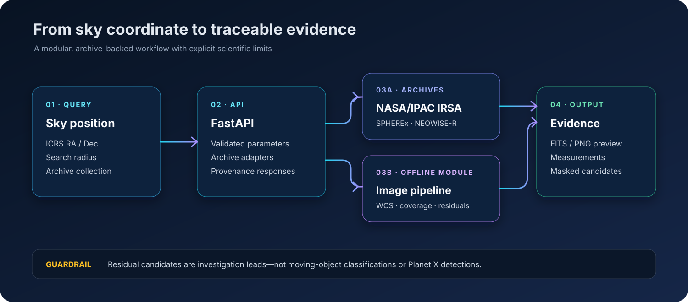

<!-- PROJECT BANNER -->
<p align="center">
  
</p>

<p align="center">
  <a href="https://github.com/NihalShore/Open-sky-benchmark/actions/workflows/backend-tests.yml">
    
  </a>
  
  
  
  <a href="LICENSE"></a>
</p>

<h1 align="center">SPHEREx TimeLens</h1>

<p align="center">
  <strong>Explore the infrared sky across position, wavelength, and time.</strong><br>
  An API-first research prototype for working with public SPHEREx and NEOWISE archive data.
</p>

<p align="center">
  <a href="https://open-sky-timelens.vercel.app/" target="_blank">Live demo</a> ·\n  <a href="#what-it-does">Capabilities</a> ·
  <a href="#quick-start">Quick start</a> ·
  <a href="#api-at-a-glance">API</a> ·
  <a href="backend/README.md">Backend guide</a> ·
  <a href="docs/using-timelens.md">Using TimeLens</a> ·
  <a href="#scientific-integrity">Scientific integrity</a>
</p>

---

## What it does

TimeLens brings several archive and image-analysis steps into one small, reproducible backend. Start with a sky position, discover relevant observations, inspect real FITS data, and compare compatible image planes while keeping coverage and provenance visible.

**The project is an investigation tool, not a Planet X detector.** A residual or catalog row is a lead for further analysis—not a discovery.

### Current capabilities

| Capability | What is implemented |
|---|---|
| **SPHEREx discovery** | IRSA SIA2 searches for DR1 / QR3 spectral-image metadata |
| **HiPS spectral viewer** | Official IRSA 102-channel PNG frames with blink, swipe, side-by-side and display-value comparison |
| **SPHEREx DR1 cube** | Bounded FITS retrieval, channel extraction, transparent coverage masking and FITS-WCS query-pixel mapping |
| **NEOWISE-R** | Single-exposure measurements, quality metadata and AllWISE / 2MASS positional-association evidence |
| **WCS registration** | Bilinear reprojection of a target image onto a reference celestial grid |
| **Difference analysis** | Common-coverage masking and robust residual ranking using median absolute deviation |

<p align="center">
  
</p>

## Live demo

<https://open-sky-timelens.vercel.app/> — deployed archive-backed web explorer. The FastAPI service is deployed at <https://open-sky-timelens-api.vercel.app>.

See the [TimeLens user guide](docs/using-timelens.md) for the field-to-archive workflow and how to interpret each view.

## Project status

> **Research prototype · Public archive explorer + FastAPI service**
>
> Archive queries depend on IRSA availability and may be rate-limited. Automated tests use generated FITS fixtures and mocked archive responses; they do not prove that every live archive request will succeed.

| Available now | Not implemented or not yet validated |
|---|---|
| Coordinate-validated FastAPI endpoints and bounded IRSA queries | Calibrated multi-epoch comparison with PSF matching and uncertainty propagation |
| SPHEREx SIA2, DR1 cube discovery and 102-channel HiPS display viewer | PSF matching or photometric scaling across epochs |
| Separate FITS-derived channel preview with NHITS coverage and FITS-WCS coordinate mapping | Uncertainty-map propagation |
| NEOWISE-R single-exposure data, reversible quality screen and positional catalog-association evidence | Automated source linking, trajectory fitting or moving-object classification |
| WCS reprojection and difference primitives | Automated Planet X detection or scientifically validated candidate confirmation |

## Quick start

The frontend and API are separate Vercel projects. The frontend uses the web directory; the FastAPI service uses the backend directory. The browser API base is open-sky-timelens-api.vercel.app.


**Requirements:** Python 3.11 recommended. Install and run from the `backend/` directory.

```bash
cd backend
python -m venv .venv

# macOS / Linux
source .venv/bin/activate

# Windows PowerShell
# .venv\Scripts\Activate.ps1

python -m pip install --upgrade pip
python -m pip install -r requirements.txt
python -m uvicorn app.main:app --reload --port 8000
```

Then open:

- **Interactive API docs:** [http://127.0.0.1:8000/docs](http://127.0.0.1:8000/docs)
- **Health endpoint:** [http://127.0.0.1:8000/api/v1/health](http://127.0.0.1:8000/api/v1/health)

The health endpoint checks that the API process is alive. It deliberately does not make a remote IRSA request.

## API at a glance

| Method | Endpoint | Purpose |
|---|---|---|
| `GET` | `/api/v1/health` | Local process health; does not contact IRSA |
| `POST` | `/api/v1/search` | Search SPHEREx spectral-image products through IRSA SIA2 |
| `GET` | `/api/v1/hips/metadata` | Read the official HiPS wavelength table |
| `GET` | `/api/v1/hips/frame/{tile_id}/{channel_index}` | Proxy one display-only IRSA HiPS PNG frame |
| `GET` | `/api/v1/cube/search` | Find DR1 All-Sky Cube FITS products around an ICRS position |
| `GET` | `/api/v1/cube/preview` | Inspect and render one FITS channel, with coverage and WCS metadata |
| `GET` | `/api/v1/neowise/search` | Query bounded NEOWISE-R single-exposure measurements |

### Example: discover SPHEREx observations

```bash
curl -X POST http://127.0.0.1:8000/api/v1/search \
  -H "Content-Type: application/json" \
  -d '{
    "ra_deg": 127.69444,
    "dec_deg": -39.17760,
    "radius_arcsec": 36,
    "collections": ["spherex_dr1", "spherex_qr3"]
  }'
```

### Example: preview a DR1 cube channel

```bash
curl -o channel-1.png \
  "http://127.0.0.1:8000/api/v1/cube/preview?ra_deg=127.69444&dec_deg=-39.17760&channel_index=0"
```

The channel index is zero-based. The FITS preview is rendered separately from the HiPS viewer. It preserves uncovered pixels as transparent and returns a query-pixel location only when the FITS celestial WCS maps the requested coordinate inside the image. It is for visual inspection, not calibrated photometry.

### Example: query NEOWISE-R

```bash
curl \
  "http://127.0.0.1:8000/api/v1/neowise/search?ra_deg=127.69444&dec_deg=-39.17760&radius_arcsec=15"
```

Measurements are returned in MJD order and capped by the requested limit. The response preserves astrometric uncertainty, photometric and transient-quality fields, AllWISE / 2MASS positional associations and the IRSA solar-system association flag. Positional associations are not confirmed source identities; per-exposure identifiers are not persistent source IDs. See the [user guide](docs/using-timelens.md) for interpretation limits.

## WCS comparison pipeline

The lower-level comparison utility is available as `app.services.image_pipeline.compare_wcs_images`. It reprojects a target plane onto a reference WCS, estimates interpolation support from finite input pixels, masks insufficiently covered pixels, and computes target-minus-reference residuals.

Inputs must already have compatible units and photometric calibration. The pipeline does **not** perform background matching, PSF matching, photometric scaling, or uncertainty propagation. See the [backend guide](backend/README.md) for details and an example.

## Run the tests

```bash
cd backend
python -m pytest -q
```

GitHub Actions is configured to run the backend test suite on relevant pushes and pull requests. The tests use generated FITS fixtures and mocked remote archive calls; live IRSA access remains an external dependency.

## Deployment layout

- Frontend: Vercel project open-sky-timelens, root directory web.
- API: Vercel project open-sky-timelens-api, root directory backend.
- CORS: TIMELENS_CORS_ORIGINS overrides the default production, preview and local origins.
- Python: API runtime pinned in backend/.python-version.

## Scientific integrity

TimeLens is intentionally conservative about what its outputs mean:

1. **Preserve provenance.** Keep archive identifiers and source information with returned products.
2. **Inspect FITS structure.** Do not assume the primary HDU is the science image; inspect the relevant extensions.
3. **Respect coverage.** Pixels without valid input coverage are masked, not interpreted as zero-valued measurements.
4. **Compare like with like.** Inputs to image subtraction must already be on compatible grids, units, and photometric scales.
5. **Treat residuals as candidates.** A difference image or high-significance pixel is not proof of motion, an unknown object, or Planet X.
6. **Separate test data from observations.** Synthetic fixtures are for tests only and must never be presented as NASA archive measurements.

## Data sources

- [NASA/IPAC IRSA — SPHEREx data access](https://irsa.ipac.caltech.edu/spherex-archive-documentation/spherex-data-access/)
- [SPHEREx data releases](https://irsa.ipac.caltech.edu/spherex-archive-documentation/spherex-data-releases/)
- [IRSA tutorial — Introduction to SPHEREx spectral images](https://caltech-ipac.github.io/irsa-tutorials/spherex-intro/)
- [SPHEREx data products and documentation](https://caltech-ipac.github.io/spherex-archive-documentation/spherex-data-products/)
- [NEOWISE data at IRSA](https://irsa.ipac.caltech.edu/Missions/wise.html)

## Roadmap

- [x] SPHEREx SIA2 observation discovery
- [x] DR1 All-Sky Cube tile discovery and channel preview
- [x] NEOWISE-R single-exposure source query
- [x] WCS reprojection and coverage-aware difference primitives
- [x] Deployed archive-backed interactive viewer and blink/swipe comparison
- [ ] Photometric / PSF matching and uncertainty propagation
- [ ] Reproducible candidate-evidence report

## Contributing

Contributions should preserve scientific provenance and avoid overstating what the data show. See [CONTRIBUTING.md](CONTRIBUTING.md) for setup, tests, and review expectations.

## License and disclaimer

Released under the [MIT License](LICENSE).

SPHEREx TimeLens is an independent community research prototype built using public archive services. It is not an official NASA, Caltech, or IPAC product and is not endorsed by those organizations.
